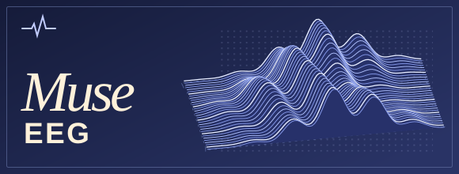
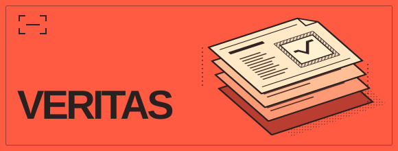

## Side A · ผลงาน

<table>
  <tr>
    <td width="50%" valign="top">
      
      
ติดตามสัดส่วนคลื่นสมองจาก Muse บนกราฟ 60 วินาที และทำแบบประเมิน PHQ-9 บนมือถือ

      <a href="https://github.com/Kimtachina/Recognition-Analysis-using-Intelligent-AI#readme"><strong>ดู Muse EEG ↗</strong></a>
    </td>
    <td width="50%" valign="top">
      
      
ดูผลสแกนรีโพซิทอรีทีละรายการ แล้วเทียบกับครั้งก่อนเพื่อดูว่าอะไรเปลี่ยนไป

      <a href="https://github.com/Kimtachina/Verification-Engine-for-Repository-Integrity-Testing-Assessment-of-Software.#readme"><strong>ดู VERITAS ↗</strong></a>
    </td>
  </tr>
</table>

## Side B · กิจกรรมบน GitHub

  
ดูสถิติการมีส่วนร่วมและยอดเข้าชมโปรไฟล์

  

    
     
    
  

